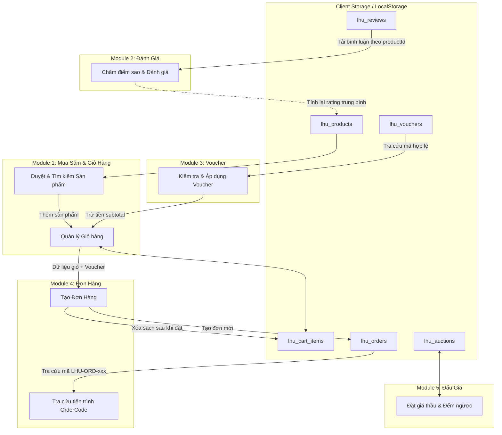

# Thiết Kế Cấu Trúc Dữ Liệu Dùng Chung (Data Architecture Spec)

Tài liệu này xác định mô hình dữ liệu chuẩn, kiểu dữ liệu, quy ước ID, quy tắc lưu trữ `localStorage`, giao tiếp giữa 5 phân hệ và tiêu chí kiểm thử cho dự án **LHU E-Commerce Platform**.

---

## 1. Quy Ước Thống Nhất Về ID & Kiểu Dữ Liệu

Tất cả các thực thể trong hệ thống sử dụng định dạng khóa chính dạng chuỗi (`string`) với tiền tố nhận diện duy nhất (`prefix_`) để tránh xung đột dữ liệu:

| Thực thể | Tiền tố ID | Quy tắc sinh ID | Ví dụ |
|---|---|---|---|
| **Danh mục (Category)** | `cat_` | `cat_[slug_khong_dau]` | `cat_laptop`, `cat_fashion` |
| **Sản phẩm (Product)** | `lhu_prod_` | `lhu_prod_[stt_3_chu_so]` | `lhu_prod_001`, `lhu_prod_002` |
| **Đánh giá (Review)** | `rev_` | `rev_[stt_3_chu_so]` | `rev_001`, `rev_002` |
| **Mã ưu đãi (Voucher)** | `vouch_` | `vouch_[stt_3_chu_so]` | `vouch_001`, `vouch_002` |
| **Đơn hàng (Order)** | `ord_` | `ord_[YYYYMMDD]_[stt]` | `ord_20261019_001` |
| **Mã vận đơn (Order Code)** | `LHU-ORD-` | `LHU-ORD-[4_so_ngau_nhien]` | `LHU-ORD-8821` |
| **Phiên đấu giá (Auction)** | `auc_` | `auc_[stt_3_chu_so]` | `auc_001`, `auc_002` |
| **Lượt đặt giá (Bid)** | `bid_` | `bid_[aucId]_[stt]` | `bid_001_1`, `bid_001_2` |

- **Kiểu số (Numbers)**: Toàn bộ tiền tệ (`price`, `subtotal`, `discountAmount`, `stepPrice`) lưu bằng số nguyên (`integer` VNĐ), không lưu ký tự định dạng (`"249.000 ₫"` chỉ dùng ở bước render giao diện).
- **Thời gian (Timestamps)**: Định dạng chuẩn ISO 8601 UTC (`YYYY-MM-DDTHH:mm:ssZ`).
- **Trạng thái (Enums)**: Lưu chuỗi chữ thường gạch dưới (`processing`, `completed`, `active`).

---

## 2. Chi Tiết Schema 5 Phân Hệ

### 2.1. Phân hệ 1: Sản phẩm & Danh mục (`js/data/products.js`)
```typescript
interface Category {
  id: string;              // "cat_fashion"
  name: string;            // "Đồng phục & Thời trang"
  icon: string;            // "👕"
  itemCount: number;       // 5
}

interface Product {
  id: string;              // "lhu_prod_001"
  name: string;            // "Balo Sinh Viên LHU Chống Nước - Phiên Bản 2026"
  category: string;        // "Đồng phục & Thời trang"
  categoryId: string;      // "cat_fashion" (Khóa ngoại tham chiếu Category.id)
  price: number;           // 249000
  originalPrice: number;   // 320000 (hoặc null nếu không giảm)
  rating: number;          // 4.8
  reviewCount: number;     // 36
  imageUrl: string;        // URL ảnh chuẩn
  badge: string;           // "Bán chạy" | "Hot" | "Mới" | "Ưu đãi" | null
  inStock: boolean;        // true
  description: string;     // Mô tả tóm tắt
}
```

### 2.2. Phân hệ 2: Đánh giá sản phẩm (`js/data/reviews.js`)
```typescript
interface Review {
  id: string;              // "rev_001"
  productId: string;       // "lhu_prod_001" (Khóa ngoại tham chiếu Product.id)
  userName: string;        // "Nguyễn Văn Hùng"
  userRole: string;        // "Sinh viên CNTT - K22"
  rating: number;          // 1 đến 5 (số nguyên)
  comment: string;         // Nội dung nhận xét
  createdAt: string;       // "2026-10-15T08:30:00Z"
  helpfulCount: number;    // Số lượt sinh viên khác bấm hữu ích
}
```

### 2.3. Phân hệ 3: Hệ thống Voucher (`js/data/vouchers.js`)
```typescript
interface Voucher {
  id: string;              // "vouch_001"
  code: string;            // "LHUTANTHUDIEU" (Viết hoa, không dấu, không khoảng trắng)
  title: string;           // "Chào đón Tân sinh viên LHU 2026"
  description: string;     // Mô tả điều kiện
  discountType: "percent" | "fixed";
  discountValue: number;   // 10 (%) hoặc 30000 (₫)
  minOrderAmount: number;  // 150000
  maxDiscountAmount: number;// 30000 (mức chặn tối đa khi tính % giảm)
  validFrom: string;       // "2026-10-01T00:00:00Z"
  validUntil: string;      // "2026-12-31T23:59:59Z"
  usageLimit: number;      // 100
  usedCount: number;       // 24
  isActive: boolean;       // true
}
```

### 2.4. Phân hệ 4: Giỏ hàng & Theo dõi đơn hàng (`js/data/orders.js`)
```typescript
interface CartItem {
  productId: string;       // "lhu_prod_001"
  name: string;
  price: number;
  quantity: number;        // >= 1
  imageUrl: string;
}

interface OrderItem {
  productId: string;
  name: string;
  price: number;
  quantity: number;
  subtotal: number;        // price * quantity
}

interface Order {
  id: string;              // "ord_20261019_001"
  orderCode: string;       // "LHU-ORD-8821" (Mã khách hàng dùng tra cứu)
  customer: {
    fullName: string;
    studentId: string;     // Mã số sinh viên LHU
    phone: string;
    email: string;
    campusAddress: string; // Cơ sở nhận hàng (CS1, CS2, KTX...)
  };
  items: OrderItem[];
  voucherApplied: {
    code: string;
    discountAmount: number;
  } | null;
  pricing: {
    subtotal: number;
    discount: number;
    shippingFee: number;
    totalAmount: number;   // subtotal - discount + shippingFee
  };
  paymentMethod: "cod_campus" | "bank_transfer";
  status: "pending" | "processing" | "shipping" | "completed" | "cancelled";
  timeline: Array<{
    status: string;
    title: string;
    description: string;
    timestamp: string;
  }>;
  createdAt: string;
  updatedAt: string;
}
```

### 2.5. Phân hệ 5: Sàn đấu giá sinh viên (`js/data/auctions.js`)
```typescript
interface Bid {
  bidId: string;           // "bid_001_1"
  bidderName: string;      // "Nguyễn V. Nam"
  bidderMasked: string;    // "Nguyễn V. N***" (Bảo vệ thông tin cá nhân)
  amount: number;          // 240000
  timestamp: string;
}

interface AuctionItem {
  id: string;              // "auc_001"
  title: string;           // "Máy Tính Khoa Học Casio fx-580VN X"
  category: string;
  seller: {
    name: string;
    studentId: string;
    faculty: string;
  };
  imageUrl: string;
  description: string;
  startingPrice: number;   // 200000
  currentPrice: number;    // 320000 (Cập nhật sau mỗi lần đặt thầu)
  stepPrice: number;       // 20000 (Bước giá tối thiểu: newBid >= currentPrice + stepPrice)
  buyNowPrice: number;     // 450000 (Tùy chọn)
  startTime: string;
  endTime: string;
  status: "upcoming" | "active" | "ended" | "cancelled";
  bids: Bid[];             // Lịch sử trả giá xếp theo thời gian tăng dần
}
```

---

## 3. Bản Đồ Giao Tiếp & Luồng Trao Đổi Giữa Các Phân Hệ



### Danh Sách Hàm Giao Tiếp Giữa Các Module (Interface Functions)

1. **`getProducts(filter?: { categoryId?: string, query?: string }): Product[]`**
   - Lấy danh sách sản phẩm theo bộ lọc từ storage/static.
2. **`getProductReviews(productId: string): Review[]`**
   - Lấy toàn bộ đánh giá của một sản phẩm cụ thể.
3. **`calculateProductRating(productId: string): { average: number, total: number }`**
   - Tính toán lại điểm số trung bình khi có người gửi đánh giá mới.
4. **`validateVoucher(code: string, currentCartTotal: number): { valid: boolean, discountAmount: number, message: string, voucher?: Voucher }`**
   - Kiểm tra mã còn hạn, đủ giá trị đơn tối thiểu `minOrderAmount`, chưa vượt quá `usageLimit`.
5. **`createOrder(customerInfo, cartItems, voucherCode?): { success: boolean, orderCode: string, order?: Order, error?: string }`**
   - Chuyển giỏ hàng thành đơn hàng mới, cập nhật lịch trình khởi tạo, làm trống giỏ hàng.
6. **`trackOrderByCode(orderCode: string): Order | null`**
   - Tra cứu chi tiết tiến trình đơn hàng theo mã `orderCode`.
7. **`placeAuctionBid(auctionId: string, bidderInfo, bidAmount: number): { success: boolean, message: string, updatedPrice?: number }`**
   - Đặt giá thầu mới với điều kiện `bidAmount >= currentPrice + stepPrice`.

---

## 4. Quy Tắc Quản Lý LocalStorage & Xử Lý Dữ Liệu Lỗi

### 4.1. Danh mục Storage Keys chuẩn
- `lhu_cart_items`: Mảng các mặt hàng trong giỏ (`CartItem[]`).
- `lhu_products`: Danh sách sản phẩm (khởi tạo từ `INITIAL_PRODUCTS`).
- `lhu_categories`: Danh mục sản phẩm (khởi tạo từ `INITIAL_CATEGORIES`).
- `lhu_reviews`: Danh sách nhận xét đánh giá (khởi tạo từ `INITIAL_REVIEWS`).
- `lhu_vouchers`: Danh sách mã giảm giá (khởi tạo từ `INITIAL_VOUCHERS`).
- `lhu_orders`: Lịch sử các đơn hàng đã đặt (khởi tạo từ `INITIAL_ORDERS`).
- `lhu_auctions`: Danh sách các phiên đấu giá (khởi tạo từ `INITIAL_AUCTIONS`).
- `lhu_user_prefs`: Cài đặt cá nhân sinh viên (chế độ xem, cơ sở học tập mặc định).

### 4.2. Nguyên tắc an toàn dữ liệu
1. **Khởi tạo có điều kiện (`initializeStorageItem`)**: Khi người dùng vào website lần đầu, hệ thống chỉ ghi nạp dữ liệu mẫu vào `localStorage` nếu khóa đó chưa có dữ liệu (`null` hoặc `undefined`). Không ghi đè nếu dữ liệu người dùng đã tồn tại.
2. **Bắt lỗi Parse JSON (`try / catch`)**: Mọi lệnh `getStorageItem` đều được bọc trong khối kiểm tra an toàn. Nếu chuỗi trong storage bị can thiệp hỏng hoặc sai cú pháp JSON, hàm sẽ ghi nhật ký cảnh báo và tự động trả về `defaultValue` (mảng rỗng hoặc null) mà không làm sập ứng dụng.
3. **Kiểm tra vượt hạn ngạch bộ nhớ (`QuotaExceededError`)**: Nếu người dùng lưu quá dung lượng 5MB của trình duyệt, hàm `setStorageItem` bắt lỗi `error.name === "QuotaExceededError"` và thông báo dọn dẹp thay vì gây crash.
4. **Không tin tưởng tuyệt đối dữ liệu từ client**: Khi tính tổng đơn hàng, hàm xử lý luôn đối chiếu lại giá trị gốc `price` của từng `productId` trong danh mục sản phẩm thay vì tin giá lưu trong giỏ hàng để tránh gian lận sửa giá trên DevTools.

---

## 5. Tiêu Chí Kiểm Thử Cấu Trúc Dữ Liệu (Test Criteria)

| Mã test | Kịch bản kiểm thử | Kết quả mong đợi |
|---|---|---|
| **TC-DATA-01** | Kiểm tra tính duy nhất của ID trong toàn bộ file mẫu (`INITIAL_*`) | Không có 2 bản ghi nào cùng loại trùng ID. |
| **TC-DATA-02** | Toàn vẹn tham chiếu `productId` trong Reviews và Orders | 100% `productId` trong `reviews.js` và `orders.js` đều tồn tại trong `products.js`. |
| **TC-DATA-03** | Khởi tạo storage lần đầu tiên | Khi `localStorage.clear()` rồi tải trang, các khóa `lhu_*` tự động nạp đủ dữ liệu mẫu. |
| **TC-DATA-04** | Xử lý dữ liệu hỏng trong `localStorage` | Ghi chuỗi không hợp lệ `"{invalid_json"` vào `lhu_cart_items`, hàm `getStorageItem` bắt lỗi êm ái, trả về `[]` và không làm crash giao diện. |
| **TC-DATA-05** | Quy tắc bước giá đấu giá | Đặt giá bé hơn `currentPrice + stepPrice` phải bị từ chối với thông báo lỗi cụ thể. |
| **TC-DATA-06** | Quy tắc điều kiện áp dụng Voucher | Nhập voucher khi giỏ hàng chưa đạt `minOrderAmount` phải báo lỗi "Đơn hàng chưa đạt giá trị tối thiểu". |
